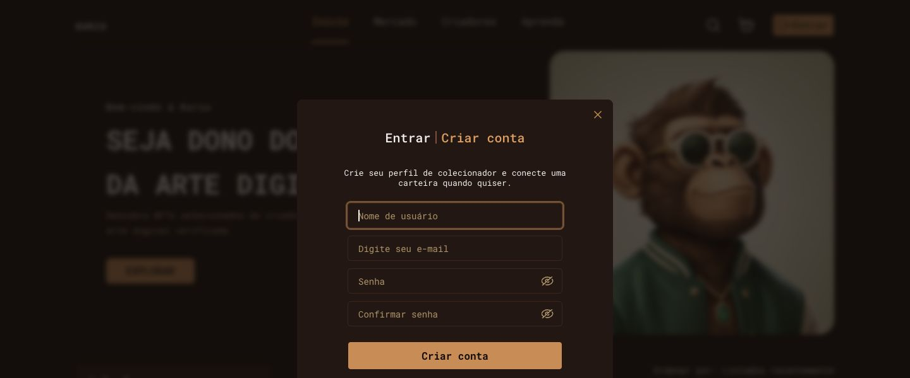
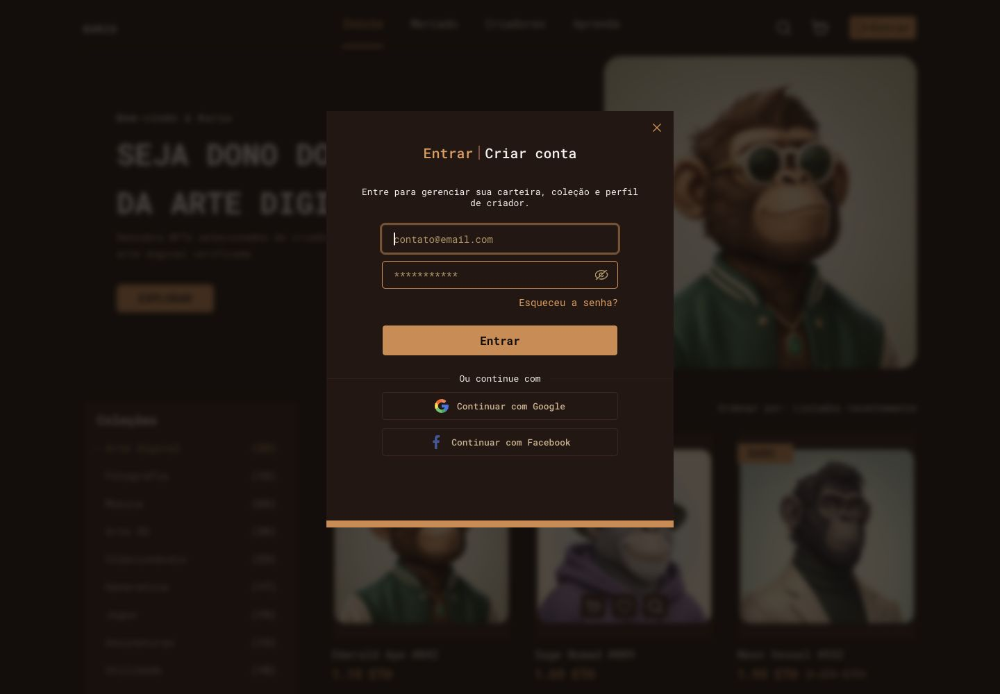
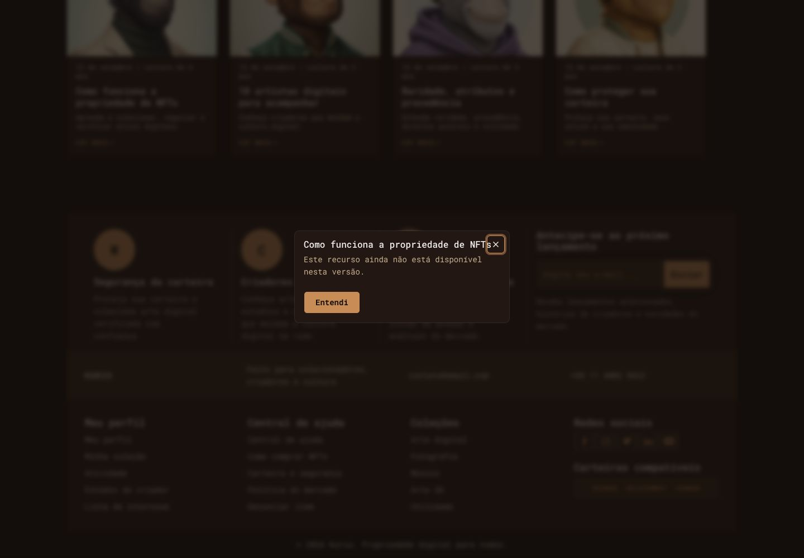
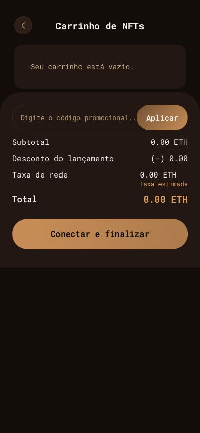
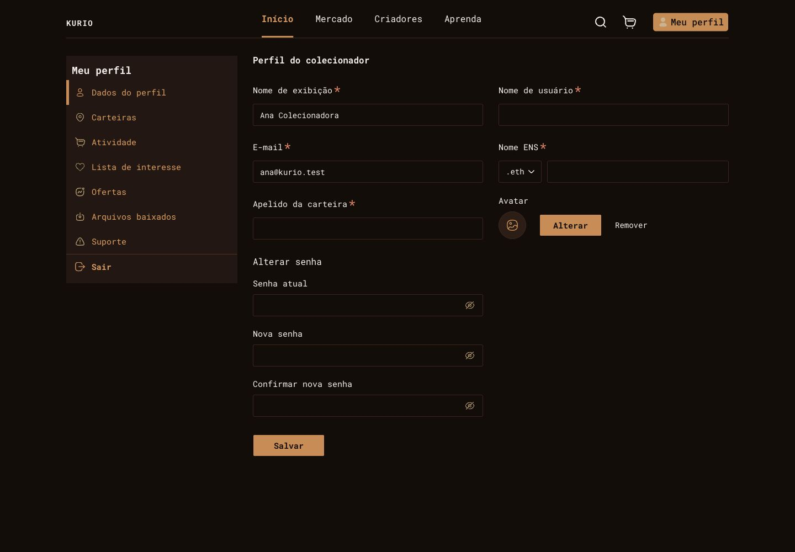
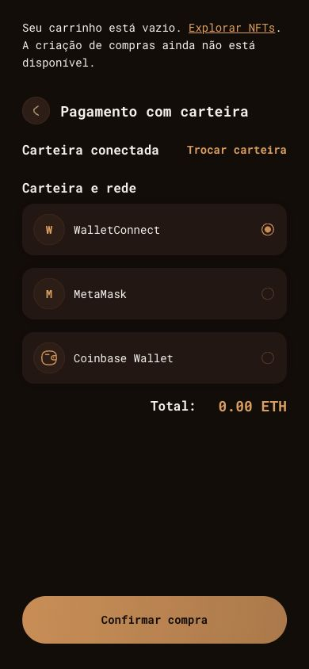
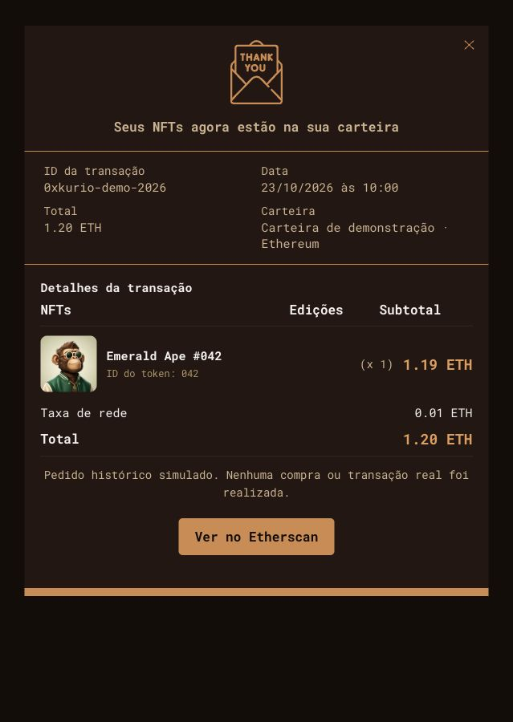
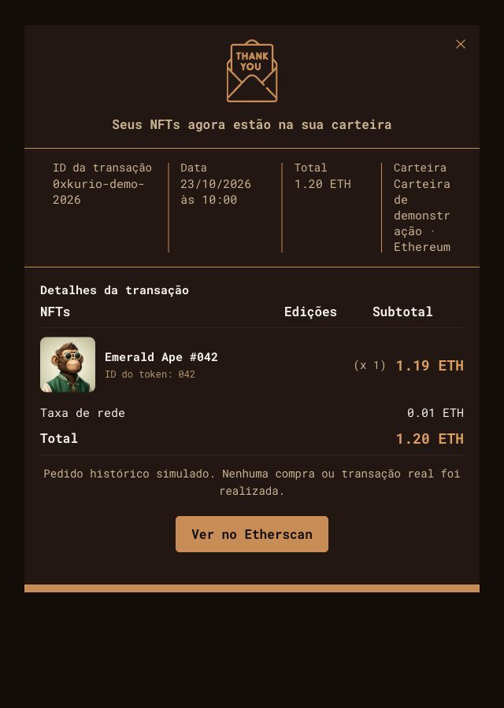
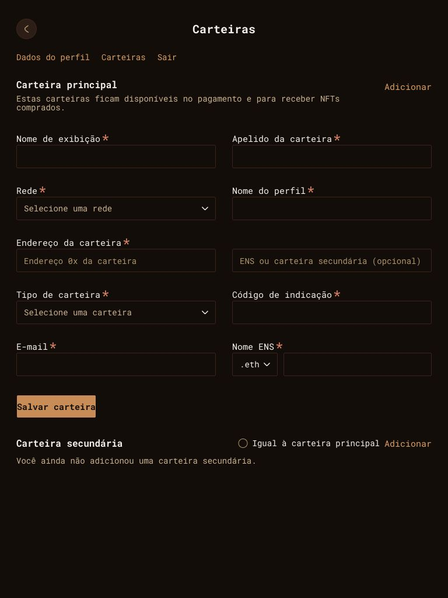

# Auditoria de UI e UX — Kurio

**Data:** 23/10/2026, horário de Brasília. **Superfície:** aplicação local em `http://localhost:5173`, no estado do diretório de trabalho. **Objetivo da auditoria inicial:** encontrar e documentar problemas reproduzíveis, sem implementar correções.

**Atualização após autorização do usuário:** os 11 defeitos confirmados foram corrigidos e verificados no recorte da [spec 005](../specs/005-correcoes-auditoria-ui-ux.md). Consulte o [acompanhamento das correções](#correções-implementadas-e-verificação). O diagnóstico, as medidas e as capturas originais abaixo documentam o estado anterior à correção.

## Resultado da auditoria inicial

Foram identificados **11 defeitos confirmados: 1 de severidade alta, 8 média e 2 baixa**. Os maiores riscos são o conteúdo de autenticação inacessível por rolagem em janelas baixas, a perda de contexto e foco ao fechar o login e o contraste insuficiente em controles.

As telas principais foram inspecionadas nas larguras de **390, 768 e 1440 px**. Isso comprova a cobertura indicada abaixo, não uma auditoria exaustiva de todas as combinações de dados, dispositivos e estados. Há sugestões e hipóteses separadas dos defeitos.

Não foi encontrada uma falha ortográfica inequívoca nos textos percorridos. Foram encontrados problemas de rotulagem, apresentação de texto, consistência e legibilidade. Os nomes de NFTs em inglês foram preservados como conteúdo intencional.

## Ambiente e método

- Navegador integrado do Codex, superfície `iab`, no macOS. A versão exata do motor não foi obtida; não se presume equivalência com a versão do Chromium dos E2E do repositório.
- Servidor local já disponível, reutilizado nesta execução. Não foi necessário instalar dependências nem iniciar outro servidor.
- Viewports principais: **390 × 844**, **768 × 1024** e **1440 × 1000 CSS px**, com DPR 1 observado. Complementos: 1440 × 600, 1023 × 600, 1024 × 600, 639 × 900 e 640 × 900.
- Dados de demonstração do MSW; login com a conta fictícia Ana documentada no README. Credenciais inválidas também foram exercitadas. A sessão criada para a inspeção foi encerrada.
- Navegação exploratória conduzida por ferramentas de navegador: cliques, teclado, rolagem, formulários, snapshots de DOM/árvore de acessibilidade, screenshots e leitura pontual de estilos computados.
- Inspeção estática dos componentes relacionados para confirmar causas. Cálculos de contraste feitos com as cores observadas nos estilos, sem usar a cor de pixels com antialiasing.
- As capturas deste relatório foram produzidas nesta execução. Capturas iniciais cortadas ou com transição visual inadequada foram descartadas ou substituídas. Imagens de página inteira são documentação do conteúdo, não prova de que tudo aparece simultaneamente no viewport.
- Foram lidos `AGENTS.md`, os trechos pertinentes do README, `STYLE_GUIDE.md` e `docs/SDD.md`. Os registros históricos não foram tratados como comprovação do estado atual.
- Skills utilizadas: `product-design:audit`, `design:design-critique`, `design:accessibility-review` e `built-in-browser`, com as instruções de navegação disponíveis nesta sessão.

**Referências visuais:** não houve consulta ao Figma nesta execução. Portanto, nenhum achado é apresentado como divergência medida contra um frame. As baselines existentes também não foram usadas como evidência atual.

**Escopo da entrega inicial no repositório:** somente este relatório e seus artefatos. Naquela etapa não houve correção de implementação nem alteração de contratos ou estado da aplicação. A implementação autorizada posteriormente está registrada separadamente na spec 005 e no acompanhamento ao final deste relatório.

## Cobertura por etapa

Legenda: **I** = inspecionado por navegação nesta execução; **—** = não inspecionado nessa combinação. A coluna de saúde resume apenas o recorte observado.

| Etapa | Tela / fluxo | 390 | 768 | 1440 | Estados e ações observados | Saúde do recorte |
| --- | --- | --- | --- | --- | --- | --- |
| 1 | Início e catálogo `/` | I | I | I | Busca, resultado vazio, atualização, filtros, ordenação, âncoras, retorno pelo histórico, seções e footer | Sem quebra global visível; oportunidades de clareza e área de toque |
| 2 | Busca, filtros e indisponibilidade | I | I | I | Busca desktop; drawer mobile/tablet; select dentro de drawer; Escape; fechamento; modal editorial; diálogo sobre login | Foco do modal comum adequado; título longo disputa espaço com fechar |
| 3 | Login e cadastro `/login`, `/register` | I | I | I | Apresentação em página e modal; login inválido/válido; rota privada retomada; alternância; recuperação indisponível; fechamento por botão, Escape e clique externo | Problemas de altura, contexto e restauração de foco |
| 4 | Detalhe `/nfts/nft-1` | I | I | I | Edições, quantidade, detalhe/avaliações, ampliação e fechamento da imagem, conteúdo relacionado | Edições mobile ambíguas; galeria funcionou nos recortes testados |
| 5 | Carrinho `/cart` | I | I | I | Vazio, cupom e navegação ao checkout | Estado vazio legível; contraste inadequado em Aplicar no layout compacto |
| 6 | Checkout `/checkout` | I | I | I | Sessão Ana, carrinho vazio, ausência de carteiras e opções de provedor | Aviso de limitação presente; título de carteira conectada contradiz o estado vazio |
| 7 | Perfil `/account/profile` | I | I | I | Campos da identidade, navegação de conta, layout e logout | Limites dos campos pouco perceptíveis; Início marcado indevidamente no desktop |
| 8 | Carteiras `/account/wallets` | I | I | I | Formulário, seção secundária vazia, navegação e espaçamentos | Botão sem padding e contraste baixo nos campos |
| 9 | Pedido e recibo | I | I | I | Confirmado em 1440; pendente/recusado em 390; recibo confirmado nas três larguras | Estados distintos; metadados do recibo fragmentados a partir de 640 px |
| 10 | Prévia `/ui-preview.html` | I | I | I | Carrinho preenchido em 390/768; pagamento preenchido em 1440; seletor de telas | Útil para revisar apresentação, com limitações ilustrativas explicitadas |
| 11 | Recuperação de recurso inexistente | — | I | — | `/nfts/missing`, mensagem e destino de retorno | Recuperação apresentada; erro 404 esperado no console |

A indicação das três larguras na etapa 9 refere-se ao **recibo**, não a todos os estados do pedido. A etapa 10 cobre as apresentações indicadas, não as nove telas completas da ferramenta de prévia.

### Evidências de navegação e aspectos que funcionaram

- Busca sem correspondência apresentou explicação e ação de limpeza. Voltar no navegador restaurou a URL anterior. Foram observados o status transitório “Atualizando catálogo…” e os controles temporariamente desabilitados. [Busca](auditoria-ui-ux/04-busca-desktop.jpg), [estado vazio](auditoria-ui-ux/05-busca-sem-resultados.jpg).
- O drawer ocupou a altura do viewport mobile, bloqueou a rolagem de fundo e devolveu o foco ao acionador. Ordenação e seleção de coleção atualizaram a URL. [Drawer](auditoria-ui-ux/14-filtros-mobile.jpg).
- No modal comum, Shift+Tab permaneceu no diálogo e o fechamento devolveu o foco ao acionador. Em reprodução por clique direto no modal editorial, `scrollY` permaneceu **2450 px antes, durante e depois**. Cabeçalho e título da home não se deslocaram ao abrir o modal comum no topo. Ver [medidas](auditoria-ui-ux/medicoes.json).
- Uma observação inicial de diferença de 16 px na rolagem, usando clique por locator, **não foi reproduzida por clique direto**. Não foi classificada como defeito da aplicação.
- Recuperação de senha abriu um segundo diálogo de indisponibilidade. Ao fechá-lo, o foco voltou a “Esqueceu a senha?”. A galeria abriu e fechou com Escape, devolvendo o foco ao acionador. [Galeria mobile](auditoria-ui-ux/16-galeria-mobile.jpg), [galeria em janela baixa](auditoria-ui-ux/20-galeria-desktop-baixo.jpg).
- Login inválido exibiu “E-mail ou senha inválidos.” com papel `alert`. O login válido permitiu acessar a conta e, na reprodução mobile, retomar `/account/profile`. Não se executou criação de conta ou troca de senha.
- Pedidos pendente e recusado não exibiram recibo confirmado. O recibo de `demo-confirmed` indicou explicitamente que nenhuma compra real foi realizada. [Confirmado](auditoria-ui-ux/27-pedido-confirmado.jpg), [pendente](auditoria-ui-ux/31-pedido-pendente.jpg), [recusado](auditoria-ui-ux/32-pedido-recusado.jpg).
- Nas amostras medidas de home e recibo em 390 px, a largura rolável do documento foi 390 px, sem overflow horizontal global. Isso não comprova ausência de overflow em todos os componentes e estados.

## Prioridades

Alta: conteúdo ou ação inacessível em uma condição de uso comum. Média: compreensão, leitura ou navegação prejudicada, com alternativa ou contexto limitador. Baixa: acabamento ou orientação local, sem bloqueio observado. Não houve defeito classificado como crítico nesta execução.

| ID | Severidade | Defeito confirmado | Área |
| --- | --- | --- | --- |
| UI-01 | Alta | Autenticação ultrapassa janela baixa sem rolagem utilizável | Responsividade / modal |
| UI-02 | Média | Abrir login substitui e desloca o catálogo ao fundo | Continuidade visual |
| UI-03 | Média | Fechar login devolve o foco ao BODY | Teclado / foco |
| UI-04 | Média | Fechar ocupa a área do título longo de um diálogo | Padding / sobreposição |
| UI-05 | Média | Texto do botão Aplicar tem contraste insuficiente | Legibilidade |
| UI-06 | Média | Bordas de campos vazios têm contraste muito baixo | Identificação de controles |
| UI-07 | Média | Checkout informa carteira conectada sem carteira | Estado / microcopy |
| UI-08 | Média | Duas opções 1/10 representam edições diferentes | Conteúdo / seleção |
| UI-09 | Média | Coluna de carteira fragmenta palavras no recibo | Tipografia / layout |
| UI-10 | Baixa | Salvar carteira está sem padding horizontal | Acabamento |
| UI-11 | Baixa | Início permanece ativo dentro da conta | Orientação / semântica |

## Defeitos confirmados

### UI-01 — Autenticação cortada em janelas baixas

**Severidade alta:** ações ficam fora da área visível e não podem ser alcançadas pela rolagem comum do mouse.

**Local:** `/register` e apresentação desktop de autenticação. Reprodução principal em 1440 × 600; confirmação no limite de 1024 × 600.

**Reprodução:** abrir cadastro no desktop, reduzir a altura para 600 px e tentar rolar o painel para acessar as opções sociais. Na reprodução em 1024 px, rolar sobre o painel manteve `scrollY = 0`.

**Observado:** em 1440 × 600, painel com `top = 158`, altura 656 e borda inferior em 814 px. Google começa em 639 px e Facebook em 691 px. O body tem `overflow: hidden` e o diálogo não possui rolagem interna. O login compartilha a abordagem de posicionamento e altura mínima.

**Esperado / impacto:** todo conteúdo deve permanecer acessível em janelas baixas. O usuário de mouse pode deixar de encontrar ações e interpretar o formulário como incompleto.

**Causa confirmada por código:** posicionamento absoluto, offsets superiores e alturas mínimas em [auth.css](../src/feature/auth/views/auth.css), linhas 145–167, sem limite de altura/overflow correspondente.

**Recomendação:** limitar o painel à altura disponível e permitir rolagem interna, ou utilizar uma composição rolável que preserve fechamento e foco.

**Critério de resolução:** em 1024 × 600 e 1440 × 600, alcançar todas as ações por mouse e teclado sem rolar o fundo. Em 1023 px a apresentação em página já mantém rolagem; preservar esse acesso.

[1023 px: página rolável](auditoria-ui-ux/51-cadastro-1023.jpg) · [1024 px: modal cortado](auditoria-ui-ux/52-cadastro-1024.jpg).

### UI-02 — Fundo do login muda e desloca elementos

**Severidade média:** perde-se continuidade visual ao executar uma ação apresentada como modal.

**Local:** home → Entrar, 1440 × 1000. Também observado com filtros e ordenação previamente alterados.

**Reprodução:** observar título e primeira linha do catálogo; clicar em Entrar; comparar o fundo; fechar o login.

**Observado:** título principal muda de **x=160/y=168 para x=168/y=186**, deslocamento de 8 px horizontal e 18 px vertical. O texto descritivo e a apresentação do catálogo ao fundo também mudam: uma seleção ordenada por menor preço passa a um espécime com “Listados recentemente”. O cabeçalho mantém a posição. Ao fechar, o título volta ao retângulo inicial. Não se comprovou perda dos filtros persistidos; o problema é a substituição visual durante o modal.

**Esperado / impacto:** preservar o contexto reconhecível ao fundo. A troca pode parecer uma atualização inesperada do catálogo.

**Causa confirmada:** a rota monta outro [AuthMarketplaceBackdrop](../src/feature/auth/views/components/auth-marketplace-backdrop.tsx), com descrição e filtros próprios, em vez da composição que estava visível. Há uma decisão histórica documentada para esse espécime; o achado é o efeito de UX observado, não uma divergência alegada do Figma.

**Recomendação:** manter a composição e o estado visual de origem ao abrir a autenticação sobre a página.

**Critério de resolução:** elementos de referência mantêm coordenadas, conteúdo e ordenação visual antes, durante e depois do modal, descontando apenas o escurecimento/desfoque.

| Antes | Durante |
| --- | --- |
|  |  |

Medidas numéricas em [medicoes.json](auditoria-ui-ux/medicoes.json), campos `homeBefore`, `loginOpen` e `homeAfter`.

### UI-03 — Foco perdido ao fechar o login

**Severidade média:** o usuário de teclado perde a posição de navegação.

**Local:** Entrar no header → login desktop → Fechar formulário, 1440 × 1000.

**Reprodução:** abrir pelo link Entrar, fechar pelo botão e consultar o elemento focado após a navegação terminar.

**Observado:** `document.activeElement` é o **BODY**. No modal comum, o mesmo tipo de fechamento retorna ao botão “Criadores”; no diálogo secundário, retorna a “Esqueceu a senha?”.

**Esperado / impacto:** devolver o foco ao acionador quando ele continua disponível, ou a um destino lógico explícito. Sem isso, a próxima navegação por teclado perde o ponto de partida.

**Causa localizada:** o login é uma rota que desmonta o acionador anterior; [AuthScreen](../src/feature/auth/views/components/auth-screen.tsx), linhas 118–127, e [AuthRoutePage](../src/feature/auth/views/auth-route.page.tsx), linha 54, não definem a restauração após o retorno. A observação de foco confirma o efeito, não uma falha interna atribuída à biblioteca.

**Recomendação:** restaurar o foco após a montagem do destino de fechamento.

**Critério de resolução:** abrir Entrar com teclado, fechar e encontrar foco visível no acionador ou destino lógico documentado; repetir com Escape.

**Evidência comportamental:** [medicoes.json](auditoria-ui-ux/medicoes.json), `loginCloseFocus` versus `commonModalClosed`. A [captura do login](auditoria-ui-ux/06-login-desktop.jpg) identifica a superfície; uma imagem estática não comprova sozinha o foco posterior.

### UI-04 — Botão de fechar invade título longo

**Severidade média:** o fim do título disputa espaço com o controle de fechamento.

**Local:** home → primeiro “Ler mais” → “Como funciona a propriedade de NFTs”, 1440 px.

**Reprodução:** abrir o diálogo editorial e navegar com Shift+Tab até Fechar para evidenciar sua área.

**Observado:** o título ocupa x=544–896 e y=434–450; o botão Fechar ocupa x=872–904 e y=426–458. Há interseção de 24 px na faixa horizontal do título. O anel de foco invade o fim “NFTs”. Em 390 px, o título quebrou em duas linhas e o efeito foi menos pronunciado.

**Esperado / impacto:** reservar espaço para o botão, sem misturá-lo ao texto. Isso facilita ler o título e reconhecer a ação separadamente.

**Causa confirmada:** fechamento absoluto em [dialog.tsx](../src/core/components/ui/dialog.tsx), linhas 64–76, e cabeçalho sem reserva equivalente à direita.

**Recomendação:** reservar a largura do fechamento e um gap no cabeçalho ou distribuir título e ação em colunas próprias.

**Critério de resolução:** título e área de foco de Fechar sem interseção em 390, 768 e 1440 px, incluindo títulos longos.

### UI-05 — Contraste baixo em Aplicar no carrinho compacto

**Severidade média:** reduz a legibilidade de uma ação disponível.

**Local:** `/cart`, 390 e 768 px; também aparece no carrinho ilustrativo da prévia.

**Reprodução:** abrir carrinho e observar Aplicar no formulário de cupom.

**Observado:** texto `#F5F1EB`, 15 px e peso 700, sobre gradiente cobre `#D28A4C` com transparência. O contraste no stop cobre é aproximadamente **2,50:1**; uma mistura de cobre a 75% sobre o card resulta em **3,82:1**. São cálculos dos estilos, não amostragem dos pixels sob cada letra.

**Esperado / impacto:** contraste suficiente ao longo da área ocupada pelo texto. O critério de texto comum pede 4,5:1; 15 px em negrito não se enquadra na exceção de texto grande. Referência: [W3C — contraste mínimo](https://www.w3.org/WAI/WCAG22/Understanding/contrast-minimum.html).

**Causa confirmada:** [cart.css](../src/feature/cart/views/cart.css), linhas 74–86, aplica tinta clara sobre o gradiente.

**Recomendação:** utilizar tinta escura adequada ao cobre ou ajustar o fundo, verificando o gradiente inteiro sob o texto.

**Critério de resolução:** pelo menos 4,5:1 em toda a região de fundo sob o rótulo, nos estados disponíveis, sem depender da aparência desabilitada.

### UI-06 — Limites dos campos vazios pouco perceptíveis

**Severidade média:** dificulta encontrar e compreender as áreas editáveis.

**Local:** perfil, carteiras e formulário desktop de checkout. Exemplos nas três larguras.

**Reprodução:** observar um campo vazio e sem foco, como Nome de usuário em perfil ou Nome de exibição em carteiras.

**Observado:** fundo interno transparente sobre `#140D0A`, borda `#3F2319`, contraste de aproximadamente **1,34:1**. Como não há preenchimento diferente e o campo está vazio, o contorno é a principal indicação de sua extensão. O foco cobre ajuda depois de entrar no controle, mas não resolve sua descoberta inicial.

**Esperado / impacto:** limites identificáveis antes do foco. A exigência de contraste não textual de 3:1 se aplica às informações necessárias para identificar controles; não é uma exigência indiscriminada para toda borda decorativa. Neste recorte, os campos vazios justificam essa revisão. Referência: [W3C — contraste não textual](https://www.w3.org/WAI/WCAG22/Understanding/non-text-contrast.html).

**Causa confirmada:** [visual-form.css](../src/core/components/form/visual-form.css), linhas 16–24, e tokens em [index.css](../src/index.css).

**Recomendação:** aumentar o contraste do limite ou diferenciar suficientemente a superfície editável, preservando a indicação de foco.

**Critério de resolução:** identificar a área editável de campos vazios e sem foco com contraste de pelo menos 3:1 para a pista visual necessária. Validar contexto e estados; não se declara conformidade WCAG global.

### UI-07 — Carteira conectada sem nenhuma carteira

**Severidade média:** comunica um estado de conexão que a tela não demonstra.

**Local:** `/checkout` autenticado como Ana, 390 e 768 px, sem carteiras salvas.

**Reprodução:** entrar na conta fictícia e acessar checkout com os dados padrão.

**Observado:** título “Carteira conectada” e ação “Trocar carteira”, seguidos de grupo de carteiras vazio. Abaixo há seleção de provedor, que não comprova uma conexão. O aviso superior informa carrinho vazio e compra indisponível, mas não explica a ausência de carteira.

**Esperado / impacto:** apresentar um estado vazio coerente. A redação pode levar o usuário a acreditar que uma carteira foi conectada.

**Causa confirmada:** [saved-wallet-selector.tsx](../src/feature/checkout/views/components/saved-wallet-selector.tsx), linhas 19–36, apresenta o título independentemente de `wallets.length`.

**Recomendação:** utilizar título e mensagem apropriados à ausência de carteiras; reservar “conectada” para o estado comprovado. Não requer inventar uma integração de carteira nesta demonstração.

**Critério de resolução:** com lista vazia, explicar que nenhuma carteira está disponível/conectada; com carteira válida, mostrar sua identidade e rede.

### UI-08 — Edições diferentes com o mesmo rótulo mobile

**Severidade média:** impede distinguir duas escolhas.

**Local:** `/nfts/nft-1`, 390 e 768 px; comparação com 1440 px.

**Reprodução:** observar as duas primeiras opções de edição e ampliar a largura para desktop.

**Observado:** mobile/tablet mostram **1/10, 1/10, 1/50, ABERTA**. No desktop, a primeira opção é **1/1**. O código associa valores diferentes, `single` e `ten`, aos dois rótulos 1/10.

**Esperado / impacto:** a mesma edição deve manter identidade inequívoca entre larguras. Usuários visuais e de tecnologia assistiva encontram escolhas com nomes iguais.

**Causa confirmada:** `mobileLabel: '1/10'` para a opção `single` em [edition-selector.tsx](../src/feature/nft/views/components/edition-selector.tsx), linhas 5–16. A inconsistência já consta do histórico do STYLE_GUIDE; ela também está presente na rota real, não apenas na prévia.

**Recomendação:** harmonizar o rótulo com a identidade da edição, validando o conteúdo pretendido; não alterar regras de negócio por inferência.

**Critério de resolução:** opções distinguíveis e consistentes em 390, 768 e 1440 px, com nomes acessíveis equivalentes à edição escolhida.

[Mobile](auditoria-ui-ux/15-nft-mobile.jpg) · [Tablet](auditoria-ui-ux/18-nft-tablet.jpg) · [Desktop](auditoria-ui-ux/19-nft-desktop.jpg).

### UI-09 — Metadados do recibo fragmentam palavras

**Severidade média:** prejudica a leitura de informações de uma transação.

**Local:** `/orders/demo-confirmed/confirmation`, 640, 768 e 1440 px. Em 639 px a apresentação em duas colunas é mais legível.

**Reprodução:** abrir o recibo como Ana e comparar larguras 639 e 640 px.

**Observado:** a coluna Carteira passa a ter apenas **73 px** e apresenta “demonstração” como “demonstr” / “ação”, com a identificação distribuída em muitas linhas. O layout desktop continua com a mesma coluna estreita mesmo havendo espaço externo.

**Esperado / impacto:** permitir ler a identidade da carteira sem fragmentação arbitrária de palavras comuns. Quebrar hashes longos pode ser necessário; não precisa governar toda a descrição.

**Causa confirmada:** colunas fixas `127px 109px 91px 73px` a partir de 640 px, combinadas com `overflow-wrap: anywhere` em [order-confirmation.css](../src/feature/orders/views/order-confirmation.css), linhas 51–55 e 79–84.

**Recomendação:** redistribuir colunas de acordo com o conteúdo, permitir span adicional para carteira ou manter duas colunas até haver espaço suficiente.

**Critério de resolução:** descrição da carteira legível em 639, 640, 768 e 1440 px, sem fragmentar “demonstração” por falta artificial de largura nem provocar overflow.

| 639 px | 640 px |
| --- | --- |
|  |  |

### UI-10 — Salvar carteira sem padding horizontal

**Severidade baixa:** acabamento inconsistente e texto encostado nas bordas.

**Local:** `/account/wallets`, 390, 768 e 1440 px.

**Reprodução:** observar o botão Salvar carteira, sem enviar o formulário.

**Observado:** `padding: 0px`; medida de largura aproximada de 137 px, praticamente toda ocupada pelo rótulo. Em contraste, Salvar no perfil possui respiro lateral.

**Esperado / impacto:** inset lateral consistente com as outras ações, mantendo texto e borda visualmente separados.

**Causa confirmada:** classe `px-0` em [wallets.page.tsx](../src/feature/wallets/views/wallets.page.tsx), linha 43.

**Recomendação:** reutilizar o padding horizontal do padrão de botão pertinente.

**Critério de resolução:** pelo menos o inset lateral do padrão adotado no projeto, sem texto encostado, recortado ou alteração indesejada da altura.

### UI-11 — Início marcado como página atual na conta

**Severidade baixa:** sinalização de localização contraditória.

**Local:** `/account/profile` e `/account/wallets`, desktop.

**Reprodução:** entrar e navegar para perfil ou carteiras; observar o menu principal.

**Observado:** “Início” recebe destaque, sublinhado e `aria-current="page"`, enquanto a seção ativa da conta também está marcada.

**Esperado / impacto:** o menu deve representar a localização atual; múltiplos níveis podem ter seção ativa, mas Início não corresponde a essas rotas.

**Causa confirmada:** [AccountShell](../src/core/components/general/account-shell.tsx), linhas 26–30, omite `active`; [SiteHeader](../src/core/components/general/site-header.tsx), linha 34, assume `home`.

**Recomendação:** permitir ausência de item ativo no menu global ou representar corretamente o contexto de conta.

**Critério de resolução:** perfil e carteiras não marcam Início como página atual; a seção de conta permanece identificável visualmente e semanticamente.

[Perfil desktop](auditoria-ui-ux/08-perfil-desktop.jpg) · [Carteiras desktop](auditoria-ui-ux/09-carteiras-desktop.jpg).

## Sugestões de melhoria — não contabilizadas como defeitos

| ID | Prioridade | Observação e impacto | Recomendação / critério de avaliação |
| --- | --- | --- | --- |
| S-01 | Média | O carrinho vazio oferece Conectar e finalizar; o checkout mantém Confirmar compra apesar da indisponibilidade avisada. Há feedback e não foi observado sucesso falso. | Dar prioridade à exploração do catálogo e explicitar indisponibilidade junto à ação, reduzindo passos sem resultado. Avaliar se o usuário entende o próximo passo sem abrir outro diálogo. |
| S-02 | Baixa | Busca desktop abre com foco no botão de pesquisar, antes do campo. Login inicia em Criar conta. São destinos focáveis, mas não os mais diretos para a tarefa principal. | Considerar foco inicial no campo pertinente, validando teclado e leitura do título do diálogo. |
| S-03 | Baixa | As opções de exibição mobile têm 20 px de altura e gap horizontal de 4 px, visualmente próximas. Isso não foi classificado automaticamente como violação WCAG. | Ampliar área de toque e separação perceptível, preservando as três opções acessíveis. [Home mobile](auditoria-ui-ux/13-home-mobile.jpg). |
| S-04 | Baixa | Há ponto decimal nos preços e totais, mas vírgula na faixa de filtros; detalhes exibem `ethereum`, enquanto filtros usam Ethereum. | Definir convenção de apresentação monetária e de nomes de redes; aplicar sem traduzir nomes próprios dos NFTs. Não se encontrou erro de cálculo real por essa diferença de formato. |
| S-05 | Baixa | Avaliações na rota real informam indisponibilidade “nesta prévia visual”, embora o usuário não esteja em `/ui-preview.html`. | Usar microcopy apropriada à superfície atual e deixar claro que os números são de demonstração. [Detalhe desktop](auditoria-ui-ux/19-nft-desktop.jpg). |

## Hipóteses que exigem validação

- **H-01 — Layout com zoom real e texto ampliado:** há entrelinhas compactas em autenticação e metadados, mas não se comprovou uma quebra causada por zoom. Tentativas de atalho não alteraram as dimensões/DPR observáveis do navegador. **Zoom de 200% permanece não verificado**; resize não foi apresentado como substituto.
- **H-02 — Barras de rolagem clássicas:** o modal comum não deslocou elementos na reprodução com clique direto neste ambiente. O comportamento com barras de rolagem que consomem largura, em outros sistemas/navegadores, ainda precisa ser testado. Não se atribuiu o deslocamento do login à remoção da scrollbar: a substituição do fundo foi confirmada no código.

## Limitações documentadas e falsos positivos evitados

- Cadastro, compra, persistência de carrinho, edição de perfil/carteiras, favoritos e outras ações continuam documentadas como indisponíveis. A ausência dessas integrações não foi reclassificada como regressão de UI. Os achados tratam de clareza e apresentação dentro desse recorte.
- O carrinho real estava vazio. Os itens e valores preenchidos vistos em `/ui-preview.html` são espécimes. A inconsistência conhecida entre a soma dos itens e o subtotal mobile da prévia não comprova erro monetário no fluxo real.
- O recibo é uma página com composição de painel e botão de fechar; não foi tratado como diálogo modal, nem exigida contenção de foco nessa página.
- Imagens lazy ainda não carregadas em uma captura inicial de página inteira não foram classificadas como assets quebrados. Um recorte inicial incompleto do navegador também foi descartado.
- O 404 e o aviso de rota no console corresponderam à reprodução intencional de `/nfts/missing`; não foram apresentados como falha inesperada.
- O shell do repositório contém alterações locais anteriores. Nenhuma delas foi revertida ou tomada como trabalho desta auditoria.

## Registro de verificação da auditoria inicial

| Tipo | Executado | Limite da evidência |
| --- | --- | --- |
| Inspeção visual | Sim: capturas atuais e comparação entre estados/larguras | Sem comparação atual com Figma; não equivale a regressão pixel a pixel |
| Execução interativa | Sim: navegação assistida por ferramentas, teclado, cliques, formulários e rolagem | Não é teste com usuários, leitor de tela ou dispositivo físico |
| Inspeção de código | Sim: componentes, CSS e configuração relacionados | Utilizada para confirmar causas; não substitui execução |
| Medições pontuais | Sim: DOM, foco, retângulos, estilos e contraste calculado | Não constituem suíte automatizada ou auditoria WCAG completa |
| Testes automatizados versionados | **Não executados** | Configurações de Playwright/Vitest e suítes existem hoje; sua presença não comprova aprovação nesta execução |
| `pnpm typecheck`, `pnpm lint`, `pnpm build` | **Não executados** | Entrega apenas documental, sem alteração de código, conforme AGENTS.md |
| Falhas/latência forçadas do MSW | **Não executadas** | Observados resultado vazio de busca, atualização transitória, login inválido e recurso inexistente; não se alega cobertura de 503, offline, race ou timeout |
| Leitor de tela e árvore completa por AT | **Não executados** | Houve inspeção pontual de DOM/árvore de acessibilidade e teclado |
| Zoom real 200% | **Não validado** | Atalhos tentados sem mudança observável; manter pendente |
| Lighthouse, axe e outros navegadores | **Não executados** | Sem pontuação, certificação de acessibilidade ou conclusão de performance |
| Revisão de conteúdo e links do relatório | Executada ao finalizar o artefato | Verificação dos destinos locais e das imagens citadas |

## Evidências adicionais por tela

Os links abaixo complementam os exemplos embutidos. Todos pertencem à execução atual; a largura está identificada pelo nome ou pela coluna da matriz.

- **Home:** [390](auditoria-ui-ux/13-home-mobile.jpg), [768](auditoria-ui-ux/44-home-tablet.jpg), [1440](auditoria-ui-ux/43-home-antes-login.jpg), [editorial antes do modal](auditoria-ui-ux/46-editorial-antes-modal.jpg).
- **Login:** [390](auditoria-ui-ux/39-login-mobile.jpg), [768](auditoria-ui-ux/38-login-tablet.jpg), [1440](auditoria-ui-ux/06-login-desktop.jpg).
- **Cadastro:** [390](auditoria-ui-ux/40-cadastro-mobile.jpg), [768](auditoria-ui-ux/41-cadastro-tablet.jpg), [1440](auditoria-ui-ux/42-cadastro-desktop.jpg).
- **Detalhe:** [390](auditoria-ui-ux/15-nft-mobile.jpg), [768](auditoria-ui-ux/18-nft-tablet.jpg), [1440](auditoria-ui-ux/19-nft-desktop.jpg).
- **Carrinho vazio:** [390](auditoria-ui-ux/23-carrinho-mobile.jpg), [768](auditoria-ui-ux/22-carrinho-tablet.jpg), [1440](auditoria-ui-ux/21-carrinho-desktop.jpg).
- **Checkout vazio:** [390](auditoria-ui-ux/24-checkout-mobile.jpg), [768](auditoria-ui-ux/25-checkout-tablet.jpg), [1440](auditoria-ui-ux/26-checkout-desktop.jpg).
- **Perfil:** [390](auditoria-ui-ux/12-perfil-mobile.jpg), [768](auditoria-ui-ux/37-perfil-tablet.jpg), [1440](auditoria-ui-ux/08-perfil-desktop.jpg).
- **Carteiras:** [390](auditoria-ui-ux/11-carteiras-mobile.jpg), [768](auditoria-ui-ux/10-carteiras-tablet.jpg), [1440](auditoria-ui-ux/09-carteiras-desktop.jpg).
- **Recibo:** [390](auditoria-ui-ux/30-recibo-mobile.jpg), [768](auditoria-ui-ux/29-recibo-tablet.jpg), [1440](auditoria-ui-ux/28-recibo-desktop.jpg).
- **Prévia ilustrativa:** [carrinho 390](auditoria-ui-ux/33-previa-carrinho-mobile.jpg), [carrinho 768](auditoria-ui-ux/34-previa-carrinho-tablet.jpg), [checkout 1440](auditoria-ui-ux/36-previa-checkout-desktop.jpg).
- **Recuperação:** [recurso inexistente em 768](auditoria-ui-ux/45-recurso-inexistente.jpg).
- **Dados de apoio:** [medidas e notas de reprodução](auditoria-ui-ux/medicoes.json).

## Correções implementadas e verificação

**Recorte autorizado posteriormente pelo usuário:** UI-01 a UI-11, implementados conforme a [spec 005](../specs/005-correcoes-auditoria-ui-ux.md). Os 11 defeitos estão corrigidos nos cenários verificados. Sugestões S-01–S-05, hipóteses H-01/H-02 e integrações de negócio pendentes permanecem fora desta entrega.

### Situação por achado

As evidências automatizadas de comportamento estão em [tests/ui-audit.spec.ts](../tests/ui-audit.spec.ts). Os nomes dos testes abaixo permitem reproduzir o recorte com `pnpm test:e2e tests/ui-audit.spec.ts --grep 'trecho do nome'`. Screenshots documentam apresentação; restauração de foco e preservação de scroll também possuem asserções próprias.

| ID | Correção e resultado verificado | Evidência |
| --- | --- | --- |
| UI-01 | Painel limitado à janela, rolagem interna e fechamento fora da área rolável. Google/Facebook alcançáveis em 1024/1440 × 600; corpo sem rolagem durante o modal. | Teste `auth actions remain reachable`; [cadastro por navegação manual](auditoria-ui-ux/correcoes/03-cadastro-rolavel-1440x600.jpg), [captura E2E](auditoria-ui-ux/correcoes/12-auth-janela-baixa.png) |
| UI-02 | Composição real do catálogo reutilizada. Filtro Golden, ordenação, textos dos cards, retângulo do título e scroll preservados ao abrir/alternar/fechar autenticação. | Teste `auth keeps the filtered catalog`; [antes](auditoria-ui-ux/correcoes/10-catalogo-antes-auth.png), [durante](auditoria-ui-ux/correcoes/11-catalogo-durante-auth.png) |
| UI-03 | Após fechar por botão ou Escape, foco retorna ao Entrar sem mover a página. Também observado manualmente no navegador integrado. | Asserções `toBeFocused` e scroll no teste de contexto; teste de janela baixa inclui acesso direto e fechamento |
| UI-04 | Títulos de diálogos com fechamento padrão reservam 40 px. Texto longo sem interseção com o alvo de fechar em 390/768/1440 px. | Teste `long dialog title`; [título e foco](auditoria-ui-ux/correcoes/04-titulo-modal-1440.png) |
| UI-05 | Texto escuro no Aplicar compacto; opacidade mínima do gradiente elevada a 80%. Contraste calculado de aproximadamente 4,90:1 a 6,85:1; asserções nos três viewports. | Testes `editions and coupon`; [carrinho real em 390](auditoria-ui-ux/correcoes/05-cupom-390.png) |
| UI-06 | Contornos de campos usam `--input`, preservando foco cobre. Contraste do contorno com o fundo da página de aproximadamente 6,72:1; campos do perfil medidos nos três viewports, demais formulários revisados nas capturas. | Testes `account controls`; [perfil real 1440](auditoria-ui-ux/correcoes/06-perfil-1440.png), [checkout desktop da prévia](../tests/design.spec.ts-snapshots/checkout-1440-darwin.png) |
| UI-07 | Título Carteiras salvas, mensagem explícita de ausência e ação Adicionar carteira no checkout vazio. Grupo de seleção vazio não é renderizado; ação abre carteiras. | Testes `account controls` em 390/768; [checkout real vazio](auditoria-ui-ux/correcoes/08-checkout-vazio-390.png) |
| UI-08 | Identificações distintas `1/1`, `1/10`, `1/50`, `ABERTA`, coerentes nas três larguras; opção 1/1 selecionável por teclado. | Testes `editions and coupon`; [detalhe da prévia em 390](../tests/design.spec.ts-snapshots/nft-390-darwin.png) |
| UI-09 | Metadados em duas colunas flexíveis, sem coluna artificial de 73 px. A palavra demonstração cabe na coluna e a página não apresenta overflow em 390/639/640/768/1440. | Testes `receipt wallet description`; [recibo real em 640](auditoria-ui-ux/correcoes/09-recibo-640.png) |
| UI-10 | Salvar carteira reutiliza padding horizontal de 20 px, verificado nos três viewports. | Testes `account controls`; [carteiras em 390, captura inteira da prévia](../tests/design.spec.ts-snapshots/wallets-390-darwin.png) |
| UI-11 | Shell da conta informa ausência de item global ativo. Início sem `aria-current="page"` em perfil/carteiras; seção da conta continua identificada. | Teste `account controls` em 1440; [perfil real](auditoria-ui-ux/correcoes/06-perfil-1440.png) |

### Verificações da implementação

| Tipo | Execução e resultado | Limites |
| --- | --- | --- |
| Inspeção de código | Componentes, CSS e rotas relacionados aos 11 defeitos; nenhum contrato de negócio alterado | Não comprova interação isoladamente |
| Execução manual | Navegador integrado, catálogo Golden, login/cadastro, janela 1440 × 600, alcance de opções por teclado, foco ao fechar e título editorial | Medições pontuais; capturas instáveis de transição descartadas |
| Revisão visual | 22 referências alteradas conferidas em 390/768/1440; cinco referências preservadas | Baselines da implementação; não houve nova consulta/comparação com Figma |
| Testes automatizados | `pnpm test:e2e`: **73 aprovados**, incluindo **15 novos**; suíte completa repetida sem atualização de snapshots | Chromium/macOS, MSW, viewports de teste; não cobre motores ou dispositivos adicionais |
| Verificações estáticas e unitárias | `pnpm typecheck`, `pnpm lint`, `pnpm test` (**30 testes**) e `pnpm build` aprovados | Não são auditoria WCAG nem testes de compra integrada |
| Capturas reproduzíveis | Testes da auditoria também registram screenshots em `test-results/`; os exemplos citados foram copiados para `auditoria-ui-ux/correcoes/` | Diferenciados das capturas manuais e dos espécimes em cada link |

A referência de carrinho desktop atualizada incorpora também a altura correta de Enviar na newsletter, ajuste anterior já documentado no STYLE_GUIDE. O componente não foi alterado novamente nesta correção. As demais atualizações de referência refletem os controles, rótulos, navegação, painéis e metadados afetados.

**Limitações mantidas:** zoom real de 200%, leitores de tela, barras de rolagem clássicas de outros sistemas, outros navegadores/dispositivos e Lighthouse continuam não verificados. Não há declaração de conformidade WCAG completa. Cadastro, compra e persistência de alterações continuam com as limitações de negócio documentadas; a entrega corrige a apresentação e as interações confirmadas na auditoria.
